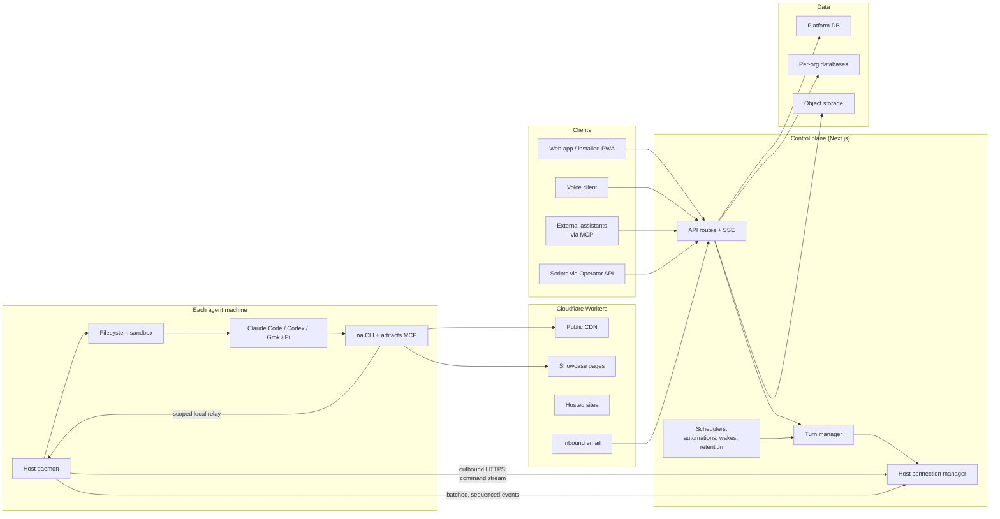

# NextAgent

**Emergent's in-house control plane for coding agents: chat, voice and fleet operations for Claude Code, Codex, Grok and Pi agents running on real machines.**

---

## What it is

NextAgent is the in-house development tool at [Emergent AI Agency](https://emergentaiagency.com): it's where the team runs its AI coding agents day to day. It isn't sold and has no outside users. The agents run on real computers (a workstation, a Mac mini, a cloud VM), and people work with them from a browser or phone. A developer points an agent at a project folder on a machine, and from then on can chat with it, watch it work, stop it, steer it mid-task, and pick up where they left off, all without a terminal. One web app manages many agents across many machines and several different AI agent tools at once.

**Why it matters to a client:** this is the system Emergent's agents build client projects with. If Emergent takes on your project, the agents doing the work run here, inside the sandbox and controls described below.

## Highlights

- **One control plane, four agent runtimes.** Claude Code (the default), OpenAI's Codex, xAI's Grok and the open-source Pi agent each run through their own adapter. All four produce the same event stream, so the chat UI, tool cards, resume, stop and token-usage tracking work the same way for every runtime.
- **Machines connect outward and need no open ports.** A small Python daemon on each machine dials the server over HTTPS, receives commands, launches agents and streams their output back. Event delivery uses per-session sequence numbers with acknowledgements and retransmission, so a dropped connection or a server restart doesn't lose events or deliver them twice.
- **Agents run inside an OS-level filesystem sandbox.** Every agent process on every runtime starts inside a kernel-enforced sandbox (Landlock on Linux, Seatbelt on macOS). If the sandbox cannot be applied, the agent does not start. Stored credentials stay with the host daemon: agents use them through short-lived, per-run tokens and never see the raw key.
- **A single capability CLI instead of a growing allowlist.** New agent abilities ship as verbs of one `na` command: web search, image, audio and video generation, PDF and spreadsheet reading, artifact and page publishing, browser checks, scheduled automations, cheap-model sub-workers. Agents get one permission rule, and a new CLI version reaches each agent on its next message.
- **Fleet operations built in.** Agents can work in parallel git worktrees, run a list of pull requests autonomously one at a time, schedule their own wake-ups and recurring automations, and watch other threads. Durable outputs (reports, HTML pages, images, PDFs) are saved as shareable artifacts through a workspace MCP server.
- **Separate data per organization.** Each organization inside NextAgent keeps its data in its own Postgres database, set up by a resumable provisioning workflow, with roles, usage and cost tracking, and an audit trail of admin actions. On a shared machine, each person's agents can run under a separate OS user.
- **Many ways in.** A responsive web app that installs to a phone or tablet home screen with push notifications; voice input; a voice-agent API with streamed speech and barge-in; a versioned Operator API with idempotency keys; and an MCP server that lets outside assistants brief, check on, message and stop the team's agents.

## NextAgent + HostKit

NextAgent is one half of Emergent's agent tooling. The other half is [HostKit](https://github.com/codeslayer44/hostkit-showcase), Emergent's in-house hosting platform that agents operate directly through MCP tools. NextAgent is where the agents work; HostKit is where what they build goes live.

Together they close the loop. Someone briefs an agent from a laptop or a phone; the agent builds the app, deploys it to HostKit with one call, waits for the health check, reads the logs and fixes what broke, then reports back in the chat. No terminal and no SSH session at any point. NextAgent itself is deployed on HostKit.

## Architecture

**How a message travels.** The browser posts a message to the control plane. The turn manager picks the agent's machine and sends a spawn command down that machine's open command stream. The host daemon starts the right runtime inside the sandbox, in the agent's project folder. A runtime-specific adapter turns the tool's raw output (Claude's stream-JSON, Grok's ACP, Codex's app-server protocol, Pi's JSON mode) into one shared event format. The daemon batches those events, numbers them, and posts them back. The control plane acknowledges them, saves the result, and relays tokens, thinking, tool calls and usage to every open browser tab over server-sent events.

More detail: [docs/architecture.md](docs/architecture.md).

## Engineering notes

**Timing bugs get a chaos harness, not more if-statements.** Every serious transport bug in the turn pipeline turned out to be about timing: a "done" arriving after an "exit", a retried batch delivered twice, an event buffer restarting its numbering mid-turn. Instead of patching each case, the project has a seeded chaos suite. It replays randomized, reordered and duplicated event schedules through the real connection manager and turn logic, and checks five rules on every run: no event is delivered twice, acknowledgements never get ahead of what was actually received, every turn finishes exactly once, no final answer is lost, and a real restart is never confused with a retry. Any failing seed can be replayed exactly.

**Adding a runtime is additive, never a rewrite.** Claude Code, Pi, Grok and Codex speak very different protocols, so each gets its own launch path and its own stream adapter, and they deliberately share no code. They all end in the same event format. A written non-regression contract says that work on a new runtime must keep the existing runtimes' test suites and a live smoke test green before it merges. Codex went from first spawn, to resume, interrupt, steer and compaction, to full control-plane support in four phases, with the existing runtimes' suites green at every step.

**The sandbox is the security boundary; tool allowlists are not.** Early versions relied on per-agent tool permission lists. Those don't hold up once an agent can run shell commands, so the design moved the boundary into the operating system. Each agent process is caged to its workspace plus explicitly granted folders, on every runtime, and the agent does not start if the cage can't be applied. Capabilities that need secrets (paid APIs, publishing, git pushes to a pinned repo) go through a local relay on the host daemon, which holds the key and hands the agent a token that is valid for one run only.

**Self-updating fleets without a deploy step on each machine.** A host release is a manifest of content-addressed components. Each machine downloads only the components whose checksum changed, verifies them, builds the new version as a set of symlinks, checks the new host code before committing to it, waits until the machine has been idle for five minutes, and swaps over atomically. If the restart fails, the previous version is put back. A build-time check refuses to publish a release that silently drops a component the previous release shipped.

**Cheap workers whose output is judged by a command, not by the model.** An orchestrating agent (say, Claude) can hand a written contract to `na worker`, which starts a disposable sub-agent on a much cheaper model in the same sandbox. If the contract includes an acceptance command, that command's exit code decides whether the work passed. The worker holds no credentials of its own and cannot outlive its parent's turn.

## Tech stack

| Layer | Choice |
|---|---|
| Web app | Next.js 16 (App Router), React 19, Tailwind CSS v4, shadcn/ui, Radix |
| Rendering | react-markdown + GFM, syntax highlighting, Mermaid, sandboxed HTML previews |
| API | Route handlers with Zod validation; server-sent events for live turns |
| Data | PostgreSQL via raw `pg` (no ORM): one platform database plus one database per organization |
| Storage | S3-compatible object storage, Cloudflare R2 |
| Edge | Cloudflare Workers: CDN, showcase pages, hosted sites, inbound email |
| Host daemon | Python standard library only, no third-party dependencies; runs on Linux and macOS |
| Agent tooling | `na` capability CLI (Python); artifacts MCP server (Node/TypeScript) |
| Agent runtimes | Claude Code, Codex, Grok, Pi (models via Anthropic, OpenAI, xAI, OpenRouter) |
| Messaging | Web Push, transactional email |
| Logging | pino structured logs |
| Testing | Vitest (unit, integration, chaos), pytest, Playwright end-to-end |

## By the numbers

| | |
|---|---|
| Commits | 3,094 |
| Active development | 2026-03-25 to 2026-10-06 |
| Tracked files | 3,490 |
| Lines of source | ~451,000 |
| Test files | 852 |
| SQL migrations | 148 |
| Languages | TypeScript 60.8%, Python 34%, HTML 3.7% |

## About this repo

NextAgent's source code is private. This repository describes the project: what it does, how it is built, and the engineering choices behind it. No source code is published here.

Built by [Emergent AI Agency](https://emergentaiagency.com) (Ryan Chappell). To talk about a project, get in touch through [emergentaiagency.com](https://emergentaiagency.com).
