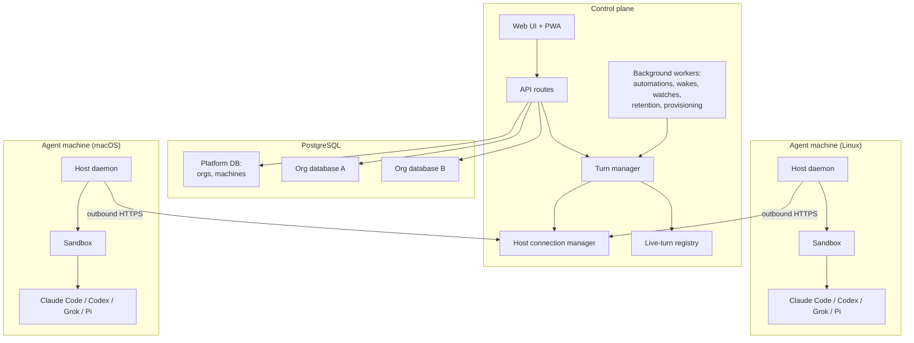
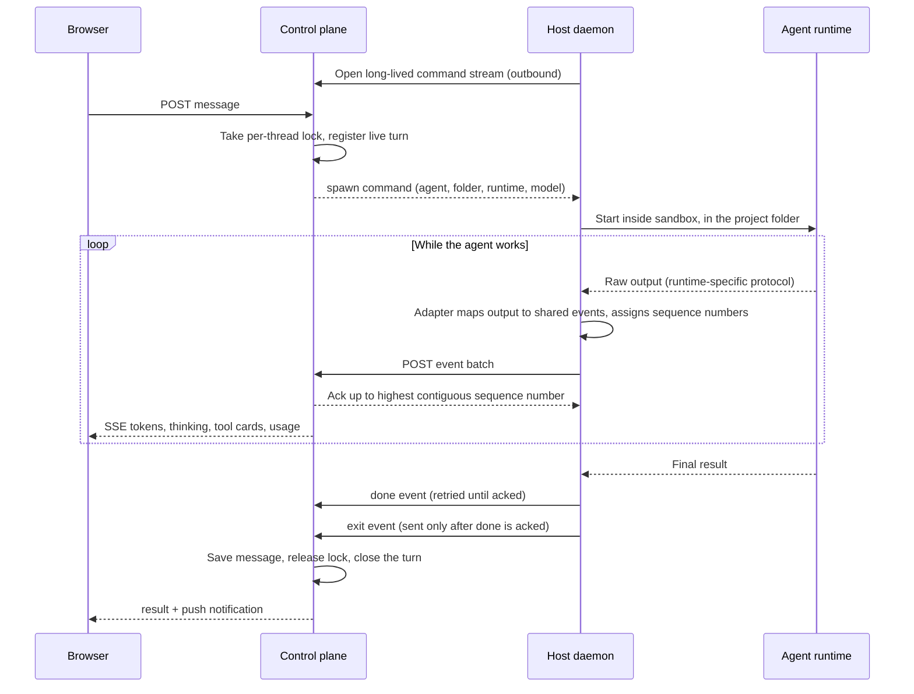

# NextAgent architecture

This document goes one level deeper than the [README](../README.md): what the main parts are, how a turn moves through them, and the decisions that shaped the design. It describes the system as it works today, not a plan.

## The three parts

NextAgent splits into a **control plane** that people talk to, **agent machines** where the work happens, and a small set of **edge workers** that serve public content.

| Part | What it does | Built with |
|---|---|---|
| Control plane | Accounts, orgs, agents, conversations, routing of turns to machines, live streaming to browsers, schedulers, admin | Next.js 16 / React 19, PostgreSQL, S3-compatible storage |
| Host daemon | Runs on each agent machine. Holds an outbound connection to the control plane, launches agent runtimes inside a sandbox, translates their output into one event format, updates itself | Python, standard library only |
| Agent-side tools | The `na` capability CLI and an artifacts MCP server, available to every agent | Python CLI, Node/TypeScript MCP server |
| Edge workers | Public CDN for published media, showcase pages, hosted static sites, inbound email | Cloudflare Workers + R2 |



## Life of a turn



A few details that matter:

- **The command channel is a server-sent event stream that the host opens.** Machines behind NAT or a home router need no inbound ports or firewall changes.
- **Events are batched on a short window** (tens of milliseconds, or as soon as a handful accumulate) to keep request counts low without adding visible latency.
- **Every event carries a per-session sequence number.** The host keeps an outbox until the control plane acknowledges each event, and retransmits anything not acknowledged. The control plane only acknowledges the contiguous prefix it has actually received, drops duplicates, and can tell a genuine outbox restart from a retried batch.
- **"done" before "exit".** The final answer is the one event that must never be lost, so it gets extra retries, and the host holds back the process-exit event until the answer is acknowledged. That ordering removed a class of turns that ended before their answer was saved.
- **Restarts don't drop running work.** When the control plane restarts (for example during a deploy), it reads the turns still marked live in the database and re-adopts them. Hosts keep streaming, cursors resume, and Stop still works. A stall watchdog ends a turn as *interrupted*, not left spinning, if its host goes quiet for too long, and a periodic sweep cleans up anything both mechanisms miss.

The shared event vocabulary is small. Rewritten for this document, its shape is roughly:

```ts
// illustrative
type HostEvent =
  | { e: "text"; sid: string; tseq: number; t: string }
  | { e: "thinking"; sid: string; tseq: number; t: string }
  | { e: "tool"; sid: string; tseq: number; id: string; state: "start" | "end" }
  | { e: "done"; sid: string; tseq: number; message: string }
  | { e: "exit"; sid: string; tseq: number; code: number }
  | { e: "error"; sid: string; tseq: number; msg: string };
```

## Runtime adapters

Each supported agent tool speaks a different protocol, so each gets its own launch path and stream adapter in the host daemon:

| Runtime | How it is driven | Adapter |
|---|---|---|
| Claude Code (default) | CLI in streaming JSON mode, with session resume | Stream-JSON processor |
| Pi | CLI in JSON mode, models through OpenRouter | Pi stream processor |
| Grok | Agent Client Protocol (JSON-RPC over stdio) | Hand-written ACP client |
| Codex | `app-server` (JSON-RPC over stdio) | Hand-written app-server client |

The adapters deliberately share no code. The protocols differ in ways that matter (how sub-agents report, how a turn ends, how cancellation looks), and a shared abstraction would have hidden those differences. What they share is the output: every adapter emits the same events, so the control plane, UI and metering treat all four the same.

The Codex client is built from the exact protocol schema that the pinned CLI version generates, not from documentation. Every CLI bump means regenerating the schema and diffing it. Minimum-host-version floors in the control plane stop a turn from being sent to a machine whose daemon is too old to serve it correctly, with a clear error, rather than letting it fail silently.

On top of the basic turn, the control plane supports **resume** (pick up the same session later), **stop**, **steer** (add instructions to a running turn, on runtimes that support it), **compaction** (summarize a long session to free context), and a live **context gauge** per thread. Sub-agent activity is filtered at the adapter, so a parent agent's chat bubble shows only its own work.

## Sandboxing and credentials

Security is designed in two layers. The details of each policy are intentionally left out here.

1. **An OS-level filesystem sandbox around every agent process.** Landlock on Linux and Seatbelt on macOS. An agent can write to its own workspace and to folders an operator has explicitly granted. If the sandbox backend is missing, the agent does not start.
2. **Credentials stay with the host, and agents get scoped tokens.** The host daemon runs a local relay. When an agent needs a paid API, a publishing bucket, image or speech generation, or a git push to its pinned repository, the `na` CLI calls the relay with a token minted for that one run. The daemon checks it, attaches the real credential, and forwards the request. Tokens are random per run, compared in constant time, never written to disk, and dropped when the run ends.

On organization machines, an admin can also run each user's agents under a separate OS user, so agents belonging to different people on one machine are isolated from each other.

A separate per-agent environment-variable tier exists for values an agent is *meant* to read, so they never have to be mixed in with credentials it should only use.

## The `na` capability CLI

Instead of widening each agent's tool permissions every time a feature is added, every new capability ships as a verb of one CLI, and agents get a single managed permission rule for it. Current verbs cover web search with citations, chat and reasoning calls to other models, embeddings and reranking, image, audio and video generation, transcription and text-to-speech, PDF and spreadsheet reading, document and data tools, publishing pages and media, static-site deploys, browser verification of a published page, git operations, self-scheduled wake-ups, recurring automations, autonomous PR runs, and cheap-model workers.

The CLI is versioned on its own. The control plane compares versions on each message and pushes an update when the agent's copy is behind, so a new verb reaches the whole fleet on each agent's next message without restarting anything.

## Fleet features

- **Worktree threads.** An agent can start a side thread in its own git worktree, so several threads work on one repository in parallel without stepping on the main checkout. Git operations run inside the same sandbox as the agent.
- **Autonomous runs.** The agent proposes a list of pull requests, and once a person presses Start, it works through them one worktree thread at a time. The run's state lives in the database, so it survives the agent compacting its own context.
- **Automations, wakes and watches.** Agents can schedule recurring background jobs, set one-shot wake-ups on their own thread, and watch other threads for completion. A scheduler claims due work per organization database and dispatches it as normal turns.
- **Workers.** `na worker` hands a written contract to a disposable sub-agent on a much cheaper model, in the same sandbox. If the contract names an acceptance command, its exit code decides pass or fail, whatever the worker claims. The worker holds no credentials and is killed with its parent's turn.
- **Artifacts.** A workspace MCP server gives every agent an `emit_artifact` tool. Reports, HTML pages, images and PDFs become durable, shareable outputs tied to the agent, user and thread.

## Data separation

- A **platform database** holds organizations and machine registration. Each organization gets **its own database**, so one team's agents, threads and files never share tables with another's.
- An organization's database is set up by a **provisioning workflow**: create database, run migrations, set up initial access, activate. Each step records its state before running and can be retried from the step that failed.
- **Migration safety rules** are enforced by a linter. Any migration that can refuse to apply must document the data condition it checks, and a deploy pre-flight reports those checks before a build starts.
- Roles, per-agent tracking of model usage and cost (with budget alerts), and audit logs for admin actions sit on top.

## Host updates

A host release is a manifest listing content-addressed components (the daemon, runtime helpers, the MCP server, a headless browser for PDF rendering, and so on) per platform. The updater:

1. fetches the manifest and compares checksums,
2. downloads and verifies only the components that changed,
3. composes the new version as a directory of symlinks into a content-addressed store,
4. checks the new daemon before committing,
5. waits for five minutes with no running sessions, then swaps atomically,
6. restarts only the services whose components changed, and
7. keeps the last few versions and garbage-collects the store.

If the restart fails, the previous version is restored. On the build side, a guard refuses to publish a release that drops a component the previous release shipped, and component tarballs are served from object storage through short-lived signed URLs.

## Clients

- **Web app.** Streaming markdown with code highlighting, Mermaid diagrams, sandboxed HTML previews, inline images and tool cards. Installable to a phone or tablet home screen, with web push notifications when a turn finishes. Token rendering is throttled so long answers don't re-render the markdown on every token.
- **Voice.** Voice input in the web app, plus a voice-agent API: an audio clip goes in, a transcript and streamed, sentence-chunked speech come out, with barge-in (talking over the reply stops it) and replay-safe turn IDs. It is built for a native phone client on a dedicated device-token login.
- **Operator API.** A versioned HTTP API for driving agents from scripts or other systems, with idempotency keys on writes and an option to wait for a turn's result.
- **MCP server.** An MCP endpoint, authenticated with personal access tokens that users create in settings, lets outside assistants (including voice assistants) get a brief on an agent, check its status, send it work and stop it. It has two wire profiles: a compact one for voice clients and a full one for text agents.

## Deliberate constraints

- **One app instance, enforced.** The turn machinery (connection routing, live-turn registry, per-thread locks) lives in process memory for speed and simplicity. Running two instances behind a load balancer would fail quietly: a machine's connection would sit on one instance while a user's message landed on the other. So the app refuses to boot in a multi-instance configuration, and the documented path to scaling out (a shared event bus, or routing each machine's traffic to one instance) is written down for when it's needed.
- **No ORM.** Raw SQL through `pg`, with Zod at the API edge. Hot paths were tuned directly: opening a long conversation used to read every row's tool-call payload, and now it doesn't.
- **NextAgent doesn't manage workspaces.** Agents point at existing project folders. Instruction files, MCP configs and skills are whatever the project already has, so anything that works in a terminal works through NextAgent.

## Testing

The repository has 852 test files across:

- **Unit and integration tests** (Vitest) for the control plane, including route contracts and wire formats.
- **Python tests** for the host daemon, runtime adapters, sandbox policy and the `na` CLI, plus a cross-platform sandbox smoke test that fails loudly instead of skipping when a check can't run.
- **A seeded chaos harness** that replays randomized, reordered and duplicated event schedules through the real connection manager and turn logic. It checks five rules on every run: at-most-once delivery, honest acknowledgements, exactly-once turn completion, no lost final answers, and correct restart detection. Any failing seed can be replayed exactly.
- **Playwright** end-to-end tests for the browser UI.
